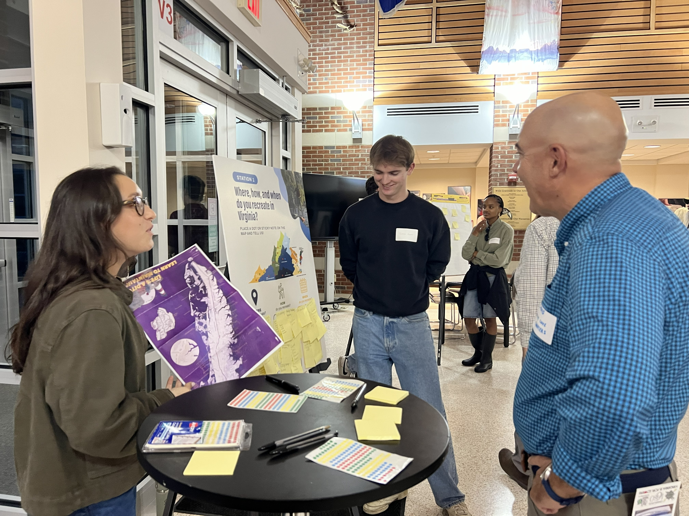

<figure class="photo-credit">
  <figcaption>
    Photo credit: Image of Onancock Hopkins and Brother Store provided by Eastern Shore of Virginia Tourism
  </figcaption>
</figure>

## The Importance of Community Participation

The history of Virginia's Eastern Shore is shaped by the people, places, traditions, and experiences of the individuals that call it home. While historical records and existing research provide an important foundation, some of the Shore's most meaningful stories are preserved through local knowledge, family histories, and personal experiences that may not be widely documented.

Community participation is essential to understanding what makes this region historically and culturally significant. The feasibility study provides an opportunity to identify important historical resources, recognize underrepresented stories, and better understand the connections between the Shore's communities and its shared heritage.

Whether you are a lifelong resident, a recent community member, a local historian, or someone with an interest in the region's history, your perspective can help shape how the Eastern Shore's heritage is understood, recognized, and preserved for future generations.

## Questions to Consider

### Important People, Places, and Events

What individuals, communities, historical sites, or events have played an important role in shaping the Eastern Shore? Are there particular landmarks, organizations, or historical figures that deserve greater recognition?

### Cultural Traditions and Community Identity

What traditions, industries, practices, and experiences have helped define life on the Eastern Shore? Consider the region's maritime heritage, agriculture, local businesses, foodways, arts, architecture, and community celebrations. What aspects of the Shore's cultural identity should be preserved and shared with future generations?

### Overlooked Stories and Underrepresented Histories

Whose stories do you feel are missing from the existing historical record? Are there particular communities, experiences, or historical events that deserve more attention? We are especially interested in identifying histories that may not be widely documented or represented in traditional accounts of the Eastern Shore.

## Contribute to the Study

Community submissions will help inform the Eastern Shore of Virginia National Heritage Area feasibility study by providing additional perspectives on the region's historical and cultural significance. The project team will review contributions to identify recurring themes, historically significant places, underrepresented stories, and opportunities for further research.

To help with this process, we invite you to contribute your knowledge and perspectives using the form below.

<iframe width="640px" height="480px" src="https://forms.cloud.microsoft/Pages/ResponsePage.aspx?id=x4A0ewc3c0iLd-IWczplrHaY0myxQdJOknAKAbb4SUdUMUxBS1NVVFpNTjBXNDhMVlk5VFdONEszUS4u&embed=true" frameborder="0" marginwidth="0" marginheight="0" style="border: none; max-width:100%; max-height:100vh" allowfullscreen webkitallowfullscreen mozallowfullscreen msallowfullscreen> </iframe>
